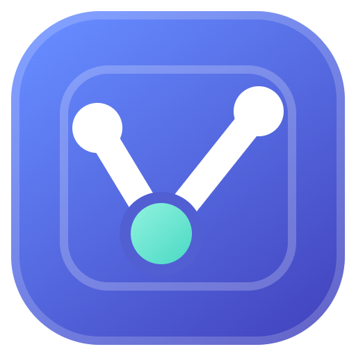
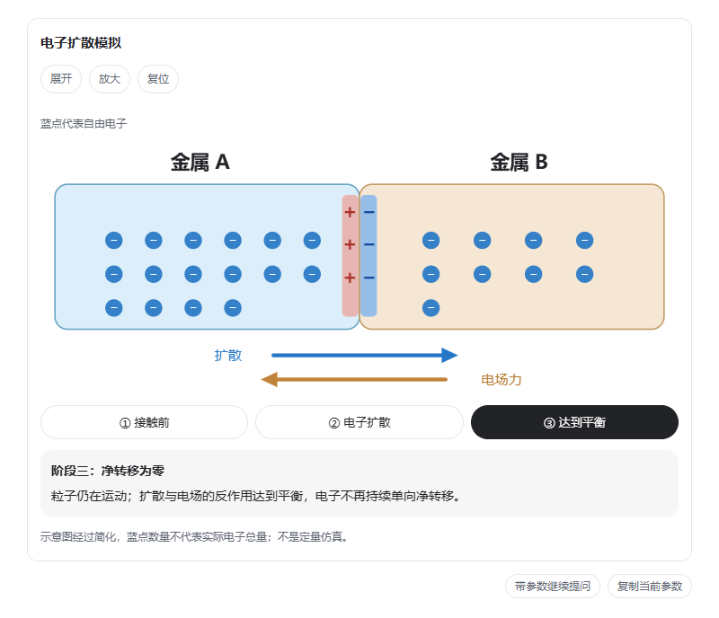
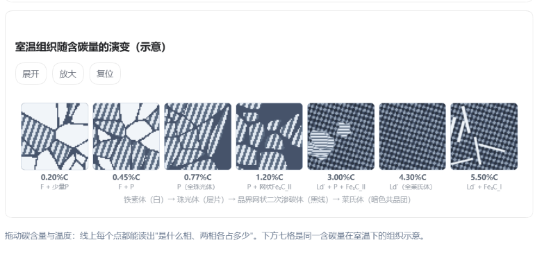
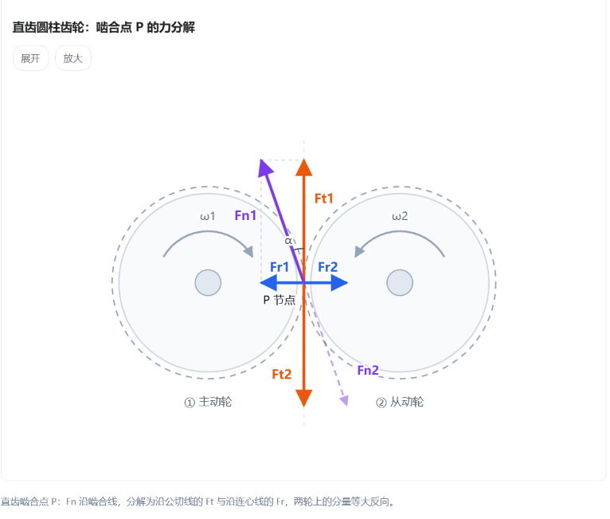
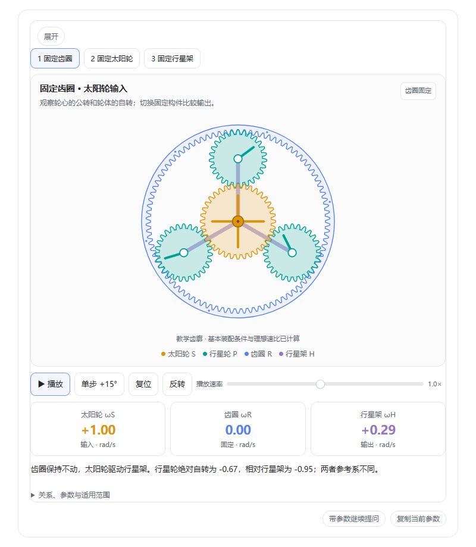
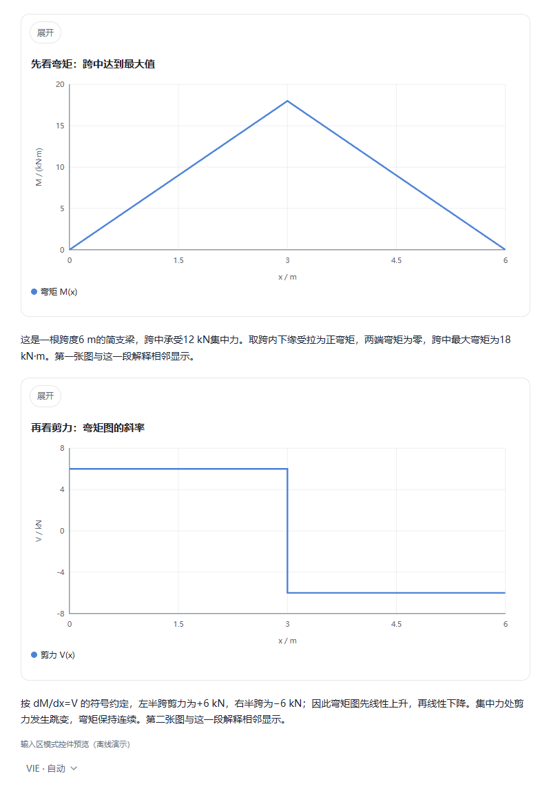

<div align="center">



# dsh-Visual-Interactive-Engine

**把回答变成看得见、能操作的解释。**

DeepSeek Harness 通用可视化插件 · 图文结合 · 动画演示 · 本地交互

[下载已发布版本](https://github.com/alccs/dsh-visual-intelligence-engine/releases/latest) · [快速开始](#快速开始) · [效果展示](#效果展示) · [架构文档](docs/ARCHITECTURE.md)

</div>

VIE 让模型在聊天中绘制图形、构建动画和交互演示。解释复杂概念时，可以一边看图、一边读正文，再通过拖动参数、切换阶段或单步播放观察变化。

**图形和交互交给 VIE，完整讲解由 Harness 正文呈现。** 图与文字按讲解顺序穿插，让每一张图都有相邻的解释。



*接触电动势示意：切换阶段，观察电子重新分布与电场的形成。图中使用教学简化模型。*

## 能做什么

| 能力 | 使用方式 |
| --- | --- |
| **通用绘图** | 根据问题绘制结构、关系、流程、时间线和自由图形；已有示例不限制可讲解的主题。 |
| **动画与模拟** | 演示运动或状态变化；支持带播放、单步、复位等控制的场景。具体操作由场景决定。 |
| **参数交互** | 用滑块、选项和输入框改变参数，在浏览器中更新图形与读数。 |
| **图表联动** | 绘制数据与函数曲线，共享参数可同时驱动多张图和自定义画面。 |
| **图文交替** | 按「图 → 解释 → 图 → 解释」组织回答，图内保留操作、必要标签与短说明。 |
| **流程图阅读** | 全景查看分支与汇合，或逐步选路径；宽分类树按父分支分组，窄屏自动重排。 |
| **逐题练习** | 一组支持 1–32 题，逐题反馈、计分和重做；点击答题在本地完成。 |
| **学习模式** | 用直观定义、因果链和主图讲清概念，按需加入应用示例与交互测验。 |
| **继续追问** | 将当前图形参数放入输入框，让后续问题接着当前状态讨论。 |

交互逻辑生成后，切换阶段、调节参数等已实现的操作在本地运行，无需为每次点击重新请求模型。需要新的解释或修改画面时，再继续对话。

### 0.31.0 的改进

同一幅 SVG 可只生成一次，通过阶段数据改变位置、高亮和读数；结构化图形修改标签时支持字段修订。混合操作任务保留 Harness 工具，空白外壳不再被当成已出图；布局反馈能指出具体对象。默认控件继续使用统一 A 风格。

三阶段公开示例的参数字节减少 44.28%，真实模型耗时尚未做 A/B。详见 [本版改进](docs/OPTIMIZATIONS-0.31.0.md) 与 [验证范围](docs/EVALUATION-0.31.0.md)。

## 效果展示

以下包含实际聊天截图，以及使用 **0.29.0 插件渲染器**截取的离线演示。README 中展示的是静态截图，安装后可操作对应场景。

### 材料与组织：把抽象变化排成一眼能比较的图

从低碳到高碳，对比室温组织的变化。图中突出组织形态与标注，材料性质和形成过程由相邻正文解释。



*实际聊天截图。组织纹理用于示意，不是金相照片。*

### 受力与几何：用方向、颜色和位置解释关系

在同一啮合点标出法向力及其分量，让受力方向与几何关系对应起来。



*实际聊天截图。可放大观察细节，完整分析继续使用 Harness 正文。*

### 机构与运动：切换条件，观察不同输出

行星轮系演示可切换固定构件、播放运动、单步推进并比较转速读数。这是可直接复用的机构示例，其他主题也可以使用通用绘图与交互能力构建。



*0.29.0 渲染器演示。齿形为教学示意，转速按示例的理想模型计算。*

### 图文讲解：每张图后面，就有它的解释

先看弯矩图及其说明，再看剪力图及其说明。长内容分段阅读，图之间的正文保留在对应位置。



*0.29.0 离线演示，展示图形与正文的排列方式。*

## 快速开始

### 1. 安装插件

所需版本已发布到 npm 时，可通过 npm 安装预构建插件。在 Harness 插件管理器中选择 npm 来源，填写 `dsh-visual-interactive-engine`；使用 Web CLI 时：

```sh
dsh plugin --profile web add dsh-visual-interactive-engine
```

需要固定版本时，在包名后追加 `@版本号`，以 npm 上实际已发布的版本为准。

也可以手动安装 TGZ：

在 [GitHub Releases](https://github.com/alccs/dsh-visual-intelligence-engine/releases) 下载所需版本的 TGZ，在 **DeepSeek Harness 桌面版的插件管理器**中安装，完成后完全退出并重新打开 Harness。

使用 Web CLI 时：

```powershell
dsh plugin --profile web add "<下载路径>/dsh-visual-interactive-engine-X.Y.Z.tgz"
```

重启承载 Web UI 的 Harness 进程。兼容范围：DSH `>=0.2.1-rc.2 <0.3.0-0`；Node.js `>=22.19`。

安装详情与排障见 [安装指南](INSTALL.md)，安装包校验值见 各版本 Release 附件中的 SHA256SUMS.txt。

### 2. 选择模式

在输入框旁的 **VIE** 菜单中选择，也可以输入命令：

| 模式 | 作用 | 命令 |
| --- | --- | --- |
| **自动** | 按问题意图判断是否需要可视化。 | `/vie auto` |
| **本聊天启用** | 明确本聊天的可视化偏好，也支持直接输入简短主题。 | `/vie on` |
| **学习模式** | 在可视化基础上，增加分阶段理解、因果解释和按需测验的讲解指引。 | `/vie study` |
| **关闭** | 停止生成新的 VIE 内容，已生成的图仍可查看。 | `/vie off` |

自动模式与学习模式共用绘图能力；自动模式不默认加入学习模式的讲解结构。当前聊天的选择独立保存；`/vie global auto` 可设置未单独配置聊天的默认模式。

### 3. 直接提问

不必先选模板，可以从你正在研究的问题开始：

```text
用图文解释接触电动势，分阶段展示电子重新分布的过程。

画出齿轮啮合点的受力分析图，标出法向力和两个分量。

解释二分查找，让我逐步查看每轮保留和排除的区间。

画出 y = A sin(ωt)，让我调节振幅和频率，观察曲线变化。
```

## 如何实现

模型根据内容生成场景数据或自定义 SVG / HTML / Canvas 等画面；VIE 负责渲染、交互状态和与聊天的衔接。常见图表、阶段切换与测验可以复用现成组件，复杂画面可自由绘制。

```text
用户提问 → 模型组织内容 → VIE 绘图与本地交互
                       → Harness 渲染正文解释
```

自定义可执行画面运行在受限 iframe 内。引擎提供统一的部分控件与主题适配，自定义画面也可拥有自己的布局和样式。

生成耗时取决于模型、内容复杂度和生成量；本地交互可以减少重复请求。图形能渲染、动画能运行，并不自动代表知识或物理模型正确，专业用途仍需核对。

## 开发与文档

```bash
npm install
npm run build
npm pack ./package
```

`src/` 为引擎源码，`package/` 为插件清单、资源与构建产物，`scripts/` 为构建和验证脚本。

| 文档 | 内容 |
| --- | --- |
| [安装指南](INSTALL.md) | 安装、配置与排障 |
| [后续规划](docs/ROADMAP-0.30.5.md) | 项目定位、能力边界与后续改进 |
| [架构说明](docs/ARCHITECTURE.md) | Host、客户端、文档模型与渲染流程 |
| [图形与控件优化](docs/OPTIMIZATIONS-0.30.5.md) | 宽度适配、A 风格组件与图形修复 |
| [版本管理](docs/VERSIONING.md) | 单一版本来源、验证与不可覆盖的本地归档 |
| [更新日志](CHANGELOG.md) | 历史版本记录 |

源码可用于构建和打包插件。`npm run verify` 使用公开回归，完整本地验收另有宿主检查；实际验证范围与数量记录在每次交付的清单中。

## 许可

[MIT](LICENSE)。第三方依赖声明见 [THIRD-PARTY-NOTICES.txt](THIRD-PARTY-NOTICES.txt)。

## 开发与版本管理

版本号统一来自 `package/package.json`，通过 `npm run version -- X.Y.Z` 或开发版本号修改；构建入口、锁文件及演示名称自动同步。`npm run verify` 执行公开回归；具备本地完整材料时可执行 `npm run verify:full`。

`npm run release` 在本地构建并归档安装包、源码和演示，记录 Git 提交、验证结果与 SHA256。同版本不同内容不能覆盖已归档交付。详见 [版本与发版流程](docs/VERSIONING.md)。
