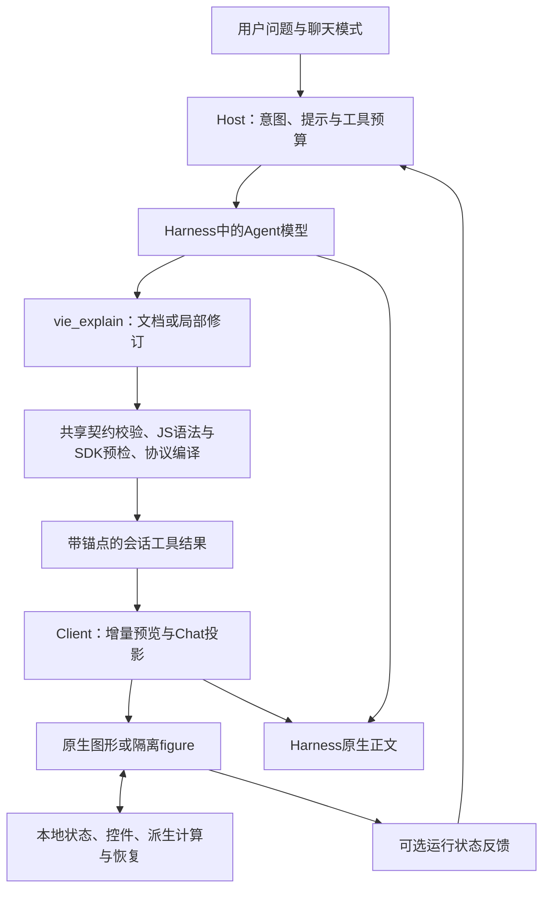

# VIE 0.30.5 架构

VIE是运行于DeepSeek Harness中的插件，包含Host与Client两个入口。它复用Harness模型、命令、会话、工具和正文能力，无独立业务服务器。技术主体为JavaScript、React、Cordis与自包含的隔离图形运行时。

## 数据流

用户操作图形时主要走R与S，不需要再次生成整段回答。需要进一步解释时，可由用户将当前参数带入提问草稿，再进入Harness对话。

## Host与生成流程

src/host.js注册六个工具：vie_explain为通用主入口；vie_auto提供可选实验快捷方式；vie_quick、vie_render、vie_compose、vie_story保留兼容用途。

src/workflow.js通过Harness生命周期钩子识别讲解、纯文字、资料读取和开发任务，管理检索、失败修复、成功图形与总请求预算。默认fastMaxRequests:8、fastMaxVisuals:3、fastMaxRepairs:2、fastMaxSearches:2；没有成功图时保留一次额外纠错机会。fastBudgetMs限制追加检索，不等同强制终止生成；fastRequestMs默认0，仅显式开启才启用等待首图的取消守卫。推理与输出默认继承Harness。

简短的三维/动画/交互追问会进入知识可视化流程；明确的项目开发与纯文字请求继续走普通流程。中止或截断后的显式“继续”可从有界公开事件恢复未完成任务，避免再次暴露整套项目开发工具。原图局部修复不额外占图数，失败草稿仍按完整视觉单元计数；待完成修复串行预留预算，不能通过并行调用绕过次数限制。

src/mode.js实现auto/on/study/off、/vie命令、按聊天偏好及状态投影。study改变教学组织指引，不切换底层模型；纯文字和开发请求仍优先。Client模式菜单同时声明remote与remote.commands依赖，命令服务断开时卸载菜单，恢复后重新绑定。

## 共享表达与校验

src/shared/catalog.js集中声明字段、组件参考和生成指引。src/shared/document.js验证并将文档编译为版本化场景事件，Host与Client使用相同源码。

- learning：主题无关的阶段与测验数据。SVG/HTML由模型自由绘制，控制外壳由引擎生成；shared/learning.js检查必填内容、答案索引、状态键及大小。
- graphic：柱图、环图、向量等数据，由引擎生成响应式figure。
- chart：公式或数据曲线、区域、断点、关键点及可绑定参数。
- visual：Flow、RelationGraph、Timeline、Diagram、Animation等声明式图形。
- figure：自包含HTML/CSS/JS，允许自由SVG、Canvas、原生WebGL与内置离线Three.js。
- experiment：可选的既有实验模型；text仅为旧数据兼容。

learning与graphic编译为GenerativeFigure。chart、visual和experiment使用对应视图。protocol.js处理场景事件、结构校验、有限表达式计算及有界缓存；chart-sampling.js处理全域覆盖和自适应细化。

Host通过vm.Script只解析生成JS语法，不执行模型程序。src/shared/sdk-preflight.js使用随包提供的Acorn解析AST，检查可确定的SDK参数、遗漏字段和重复属性；跟踪绘图变量与作用域，遇到对象展开、计算键或动态值时只验证能证明的部分。src/shared/sdk-geometry.js统一Host/Client的别名、颜色与数值规范，运行时仍检查最终值。

## 增量预览、修订与图文顺序

src/document-tool.js管理按agent隔离的修图基线、visualId、revision与原调用anchorCallId。局部修订只替换指定块；过期修订被拒绝，失败补丁不会覆盖有效原图。完整source写入工具结果，冷历史恢复不依赖临时内存。

src/client.js的SceneStore承载协议状态、共享控件、派生值、图内状态及错误。完整可解析的块可提前预览；figure 的完整 HTML 字段也可先作为不可交互的静态预览，清除脚本与事件属性，等待最终脚本就地激活。不完整 JS 不执行。view/flow-answer.js按原调用位置发布独立图形节点；成功出图轮次结束后，相关中间正文通过公开assistant-step数据投影为原生正文节点，保留最终图文顺序。最终答案避免重复，原始过程记录仍可用于诊断。旧start/tail/process继续兼容。

## 隔离运行与本地交互

view/generated.js在opaque-origin iframe中运行自定义figure，以CSP禁止联网和额外浏览上下文。消息桥检查来源窗口与通道，传递有界JSON状态、主题、可见性、尺寸、ready与运行错误。运行报错不会被标记为ready。它提供DOM和网络边界，不是完整的CPU/内存资源隔离。

工具返回的renderStatus:submitted只表示结构、语法与可确定参数已通过。src/render-feedback.js将实际ready/error与会话、完整源标识、visualId/revision绑定；客户端通过可选remote.commands通道回传，下一次模型请求最多等待300ms接收状态。迟到的旧修订不覆盖新结果；诊断以数据形式进入下一请求，不自动写入用户或助手消息。Harness仍保留command/run和command/done事件；view/command.js通过conversation.chat.commandview的vie键隐藏保留子命令__render的呈现与行占位，历史重载采用同一规则，手动命令保持可读。没有反馈通道时保持submitted，报错卡片可生成修复提问草稿。

view/learning.js统一阶段按钮、键盘操作、短说明与本地测验反馈。通用参数与derive把控件、曲线和示意图连接起来；用户操作不自动调用模型。图形外层仅提供展开/收起与有状态时的复位，iframe保持适合容器宽度；图内独立缩放继续可用。图形支持主题、窄屏阅读与原挂载状态保留。

## 存储与恢复

聊天模式保存在DSH_HOME/dsh-vie-mode.json；修图基线使用按会话哈希命名的限量文件。两者均由Harness环境提供存储位置。view/checkpoints.js保存有限本地checkpoint，只有源及会话/调用匹配才恢复；不支持天然跨设备同步。截断和显式VIE超时可从有限公开会话事件恢复，study/on下的简短主题也保留任务范围。

## 构建与交付

scripts/build.mjs确定性展开共享源码并生成组件/技能参考，生成package/lib/index.js与client.js。verify.mjs执行Node测试、19组Chrome测试、10组Host/安装脚本（包括真实运行反馈、Chat组装、隔离CLI安装和元数据验证），最后确认验证哈希未变化。release.mjs生成TGZ、源码ZIP、离线HTML及SHA256校验值。精简源码包附带通用检查与8组实际Chrome脚本，可独立安装开发依赖后复验。

这些检查覆盖软件契约与既定回归，不构成任意生成内容的专业认证，也不等于完整Electron桌面GUI或外部模型延迟A/B验收。

## 通用二维运行时（0.30）

`src/runtime/graphics.js` 注入 figure 沙箱，公开 graphicsVersion:1。SVG 助手将主题、图元、分组、标签避让与销毁封装在引擎中；Canvas 助手处理高分屏、ResizeObserver、状态与主题重绘；动画助手使用 requestAnimationFrame、可见性门控及统一控制栏，stateKey 保存位置，恢复时默认暂停。自定义领域关系由模型声明，SDK 不猜测物理规律。

`src/runtime/preview.js` 使用惰性 HTML template 片段过滤静态预览，复用匹配节点并限制 DOM 数量。最终脚本只激活一次。`mountGeneratedFigure.revise` 允许预览在同一 iframe 内结束，并合入最终初始状态。外部 document 不接受 preview 字段；只有内部预览编译路径可以使用它。预览/ready 时间分别在 iframe dataset 与控制器 metrics 中提供，均从挂载开始计时；流式 ready 时间可能包含等待最终参数，不能代替从请求开始测量的端到端生成时间。

`src/styles/controls.css` 是原生外壳与沙箱共同的基础控件令牌。模型保留内容绘制自由度；默认控件布局、焦点、禁用、触控尺寸由引擎提供。

`g.coordinates` 将数据范围映射为像素坐标，marker位置、读数与标注共用同一数值，减少分别硬编码导致的不一致。它不提供材料相区或其他领域事实。

## 通用三维运行时（0.30）

`src/runtime/scene3d.js` 基于真实Three.js提供相机、光照、旋转缩放、通用几何、主题与销毁清理；box/sphere/cylinder/torus/helix/mesh/line/group可自由组合，运动复用VIE.animate。库随插件分发，只在需要三维的figure中注入；渐进预览也在原iframe中加载本地库并完成激活，不访问CDN或另建项目。

Three.js及Acorn分别保留MIT许可证；Three.js资源增加客户端包体，但无需模型每次生成引擎实现。三维渲染需要WebGL，库本身不提供共轭齿面、真实接触或通用物理求解，结构示意需明确范围。

## 0.30.5分层与运行反馈

view/figure-view.js管理自定义图形查看、布局提示与静态回退，view/three-loader.js管理本地chunk加载；runtime/ui.js提供通用工具栏与读数，runtime/layout-audit.js执行有界、节流、仅提示的布局检查。主Client不内嵌Three.js源码；build.mjs生成client.three.js，Host标准package-local chunk路由负责按修订提供资源，iframe仍禁止联网。

首个工具提交firstSubmittedMs、收到绘制确认firstVisibleMs、收到就绪确认firstReadyMs分开统计；无确认保持未知。就绪不等待离屏iframe的绘制。浏览器局部挂载指标与Host接收时钟不相减，也不直接等同模型生成耗时。构建字节由BUILD-METRICS.json自动生成。

0.30.5 的布局约束：.vie-shell 使用宿主分配的完整宽度，不设固定像素上限。具有 viewBox 的独立静态 SVG 使用 width/max-width 100%、min-width 0、height auto；不再用字号下限撑宽画布。字体测量只负责小字提示，展开仍保留原 iframe。

A式组件统一在src/styles/controls.css定义；--vie-control-*只影响控件，语义图形仍使用原来的primary/secondary等内容色。原生Scene和隔离figure复用shared/control-presentation.js，滑轨填充跟随真实值，监听与观察器随视图销毁。该层不改写值、不派发业务事件。SDK的ui.toolbar项可用variant:primary|secondary|ghost选择按钮层级。
