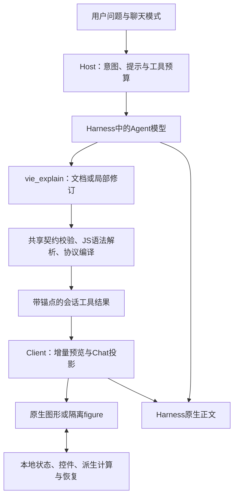

# VIE 0.29.0 架构

VIE是运行于DeepSeek Harness中的插件，包含Host与Client两个入口。它复用Harness模型、命令、会话、工具和正文能力，无独立业务服务器。技术主体为JavaScript、React、Cordis与自包含的隔离图形运行时。

## 数据流

用户操作图形时主要走R与S，不需要再次生成整段回答。需要进一步解释时，可由用户将当前参数带入提问草稿，再进入Harness对话。

## Host与生成流程

src/host.js注册六个工具：vie_explain为通用主入口；vie_auto提供可选实验快捷方式；vie_quick、vie_render、vie_compose、vie_story保留兼容用途。

src/workflow.js通过Harness生命周期钩子识别讲解、纯文字、资料读取和开发任务，管理检索、失败修复、成功图形与总请求预算。默认fastMaxRequests:8、fastMaxVisuals:3、fastMaxRepairs:2、fastMaxSearches:2；没有成功图时保留一次额外纠错机会。fastBudgetMs限制追加检索，不等同强制终止生成；fastRequestMs默认0，仅显式开启才启用等待首图的取消守卫。推理与输出默认继承Harness。

src/mode.js实现auto/on/study/off、/vie命令、按聊天偏好及状态投影。study改变教学组织指引，不切换底层模型；纯文字和开发请求仍优先。Client模式菜单同时声明remote与remote.commands依赖，命令服务断开时卸载菜单，恢复后重新绑定。

## 共享表达与校验

src/shared/catalog.js集中声明字段、组件参考和生成指引。src/shared/document.js验证并将文档编译为版本化场景事件，Host与Client使用相同源码。

- learning：主题无关的阶段与测验数据。SVG/HTML由模型自由绘制，控制外壳由引擎生成；shared/learning.js检查必填内容、答案索引、状态键及大小。
- graphic：柱图、环图、向量等数据，由引擎生成响应式figure。
- chart：公式或数据曲线、区域、断点、关键点及可绑定参数。
- visual：Flow、RelationGraph、Timeline、Diagram、Animation等声明式图形。
- figure：自包含HTML/CSS/JS，允许自由SVG、Canvas与原生WebGL。
- experiment：可选的既有实验模型；text仅为旧数据兼容。

learning与graphic编译为GenerativeFigure。chart、visual和experiment使用对应视图。protocol.js处理场景事件、结构校验、有限表达式计算及有界缓存；chart-sampling.js处理全域覆盖和自适应细化。

Host通过vm.Script只解析生成JS语法，不执行模型程序。旧SDK预检只拦截可静态判定的遗漏字段；遇到对象展开、简写、计算键、模板或正则等不猜测动态值，交由隔离视图运行校验。

## 增量预览、修订与图文顺序

src/document-tool.js管理按agent隔离的修图基线、visualId、revision与原调用anchorCallId。局部修订只替换指定块；过期修订被拒绝，失败补丁不会覆盖有效原图。完整source写入工具结果，冷历史恢复不依赖临时内存。

src/client.js的SceneStore承载协议状态、共享控件、派生值、图内状态及错误。完整可解析的块可提前预览；不完整JS不会直接执行。view/flow-answer.js按原调用位置发布独立图形节点；成功出图轮次结束后，相关中间正文通过公开assistant-step数据投影为原生正文节点，保留最终图文顺序。最终答案避免重复，原始过程记录仍可用于诊断。旧start/tail/process继续兼容。

## 隔离运行与本地交互

view/generated.js在opaque-origin iframe中运行自定义figure，以CSP禁止联网和额外浏览上下文。消息桥检查来源窗口与通道，传递有界JSON状态、主题、可见性、尺寸、ready与运行错误。运行报错不会被标记为ready。它提供DOM和网络边界，不是完整的CPU/内存资源隔离。

view/learning.js统一阶段按钮、键盘操作、短说明与本地测验反馈。通用参数与derive把控件、曲线和示意图连接起来；用户操作不自动调用模型。图形支持展开、放大、主题、窄屏阅读与原挂载状态保留。

## 存储与恢复

聊天模式保存在DSH_HOME/dsh-vie-mode.json；修图基线使用按会话哈希命名的限量文件。两者均由Harness环境提供存储位置。view/checkpoints.js保存有限本地checkpoint，只有源及会话/调用匹配才恢复；不支持天然跨设备同步。截断和显式VIE超时可从有限公开会话事件恢复，study/on下的简短主题也保留任务范围。

## 构建与交付

scripts/build.mjs确定性展开共享源码并生成组件/技能参考，生成package/lib/index.js与client.js。verify.mjs执行Node测试、8组Chrome测试、真实Host与Chat组装、隔离CLI安装和元数据验证，最后确认验证哈希未变化。release.mjs生成TGZ、源码ZIP、离线HTML及SHA256校验值。

这些检查覆盖软件契约与既定回归，不构成任意生成内容的专业认证，也不等于完整Electron桌面GUI或外部模型延迟A/B验收。
